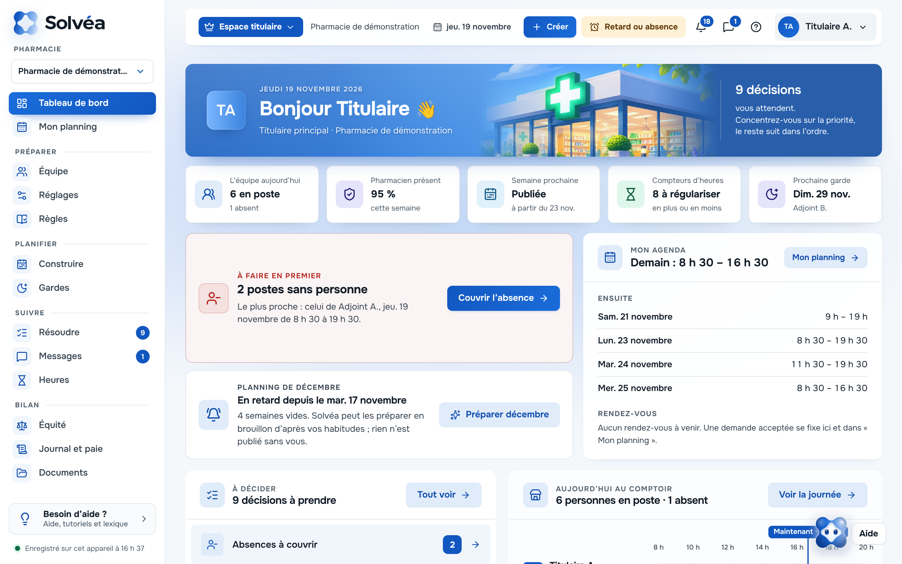
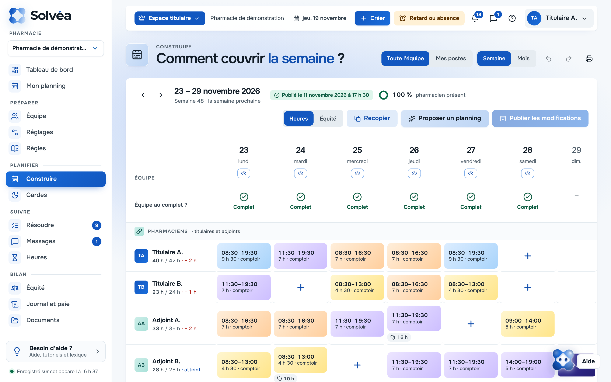
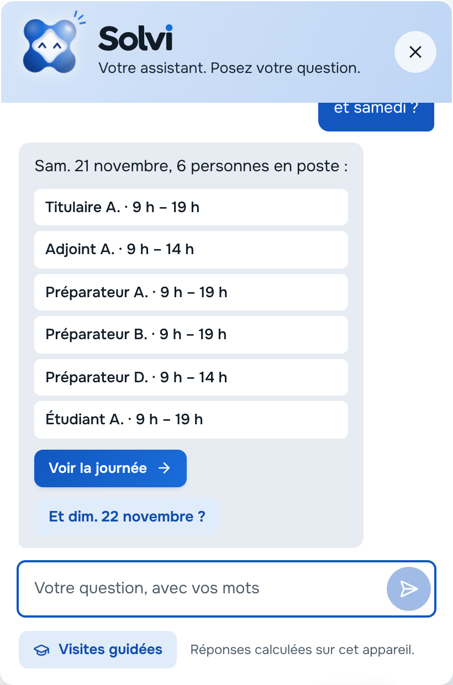
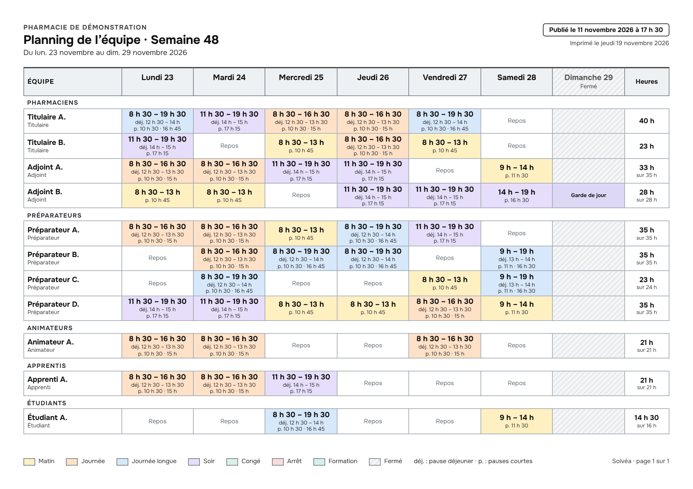
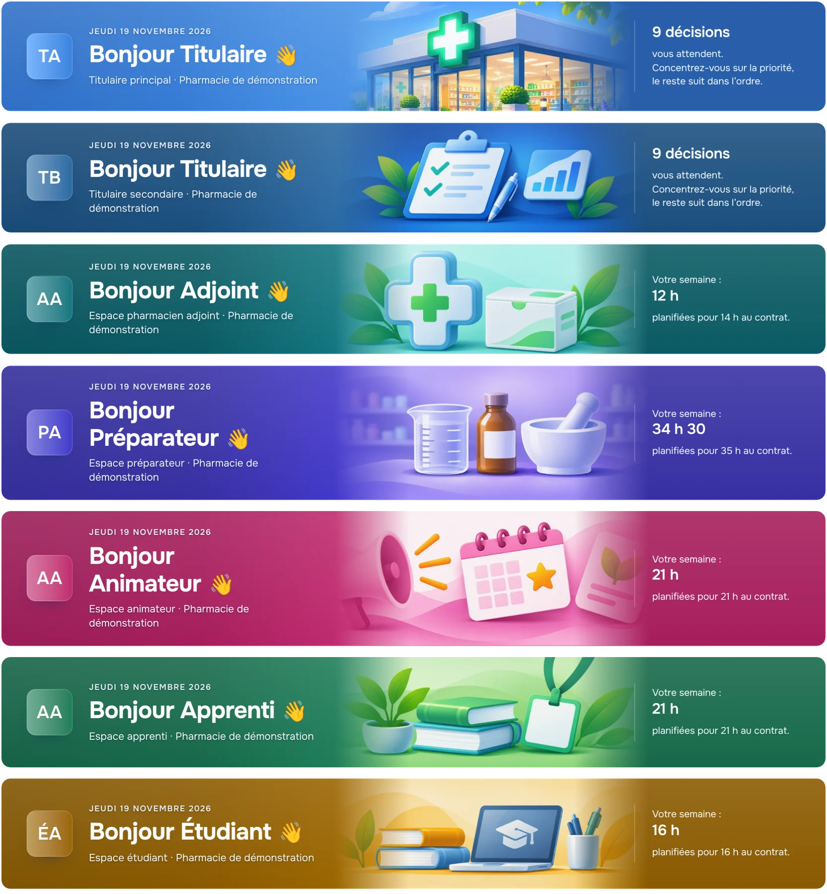
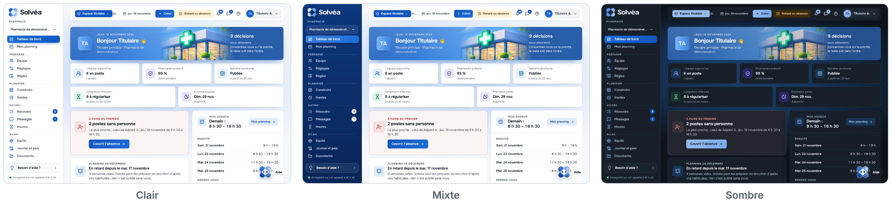
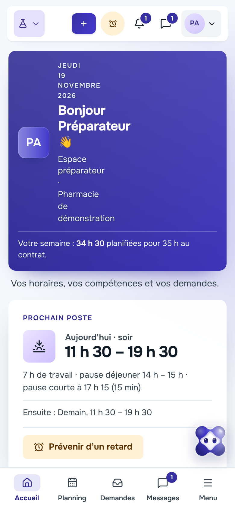

<div align="center">

<picture>
  <source media="(prefers-color-scheme: dark)" srcset="src/assets/solvea-logo-ciel-sombre.svg">
  <source media="(prefers-color-scheme: light)" srcset="src/assets/solvea-logo-ciel.svg">
  
</picture>

### Le planning d'équipe d'une pharmacie d'officine

Construire la semaine, comprendre chaque arbitrage,<br>
absorber un imprévu en dérangeant le moins de monde possible.


[Démarrer](#démarrer) · [Ce que fait Solvéa](#ce-que-fait-solvéa) · [Guide détaillé](docs/GUIDE.md) · [Bilan UX et UI](docs/BILAN-UX-UI.md)

<br>



</div>

<br>

> [!NOTE]
> Solvéa est une **aide à la décision**, pas une garantie de conformité. Il propose, explique, et ne
> publie jamais rien sans validation humaine.

## Démarrer

```bash
npm install
```

```bash
npm run dev
```

Sur la page d'accueil, **« Comment ça marche »** ouvre une pharmacie de démonstration : aucun compte à
créer, rien à saisir. On y passe d'un profil à l'autre en un clic.

## Ce que fait Solvéa

| | |
| --- | --- |
| **Construire** | La semaine entière tient dans la largeur, du lundi au dimanche. Trois propositions comparables, calculées dans le respect des règles. |
| **Publier au mois** | Une échéance, un rappel, et un brouillon préparé d'après vos habitudes si le temps manque. Rien n'est publié sans vous. |
| **Décider** | Congé, remplacement, horaires : chaque demande montre ce qu'elle implique avant qu'on tranche. Jamais un simple oui ou non. |
| **Absorber l'imprévu** | Retard, absence, accident du travail : signalés en deux gestes, pour soi ou pour quelqu'un. Les postes à couvrir arrivent avec leurs options. |
| **Aller droit au but** | Depuis « Résoudre », chaque façon de régler mène à l'endroit exact du planning, mis en évidence : la case, le bouton « Publier », la grille. |
| **Imprimer** | Un aperçu avant impression : à la semaine ou au mois, en couleur ou en noir et blanc, pour l'équipe ou pour soi, avec la pause déjeuner et les pauses courtes. |
| **Suivre** | Compteurs d'heures, équité des samedis et des fermetures, gardes, formations, fiche navette pour la paie. |
| **Se parler** | Messages, rendez-vous fixés dans l'agenda de chacun, annonces de chaque décision. |
| **Se faire aider** | Une aide qui couvre chaque fonction, un tutoriel par tâche, un lexique, Solvi, et le support en bas de chaque écran. |
| **Choisir son apparence** | Trois thèmes : clair, mixte (menu foncé, contenu clair) et sombre. On choisit dès la création de son espace, sur de petites maquettes. |

<div align="center">
<table>
  <tr>
    <td width="62%"></td>
    <td width="38%"></td>
  </tr>
  <tr>
    <td align="center"><sub>La semaine, d'un seul regard</sub></td>
    <td align="center"><sub>Solvi répond d'après le planning</sub></td>
  </tr>
  <tr>
    <td colspan="2"></td>
  </tr>
  <tr>
    <td colspan="2" align="center"><sub>La feuille à afficher, telle qu'elle sort de l'imprimante</sub></td>
  </tr>
</table>
</div>

## Un espace par profil

Chaque profil a sa couleur, son accueil et le dessin de sa bannière : on sait d'un coup d'œil où l'on se
trouve. Chacun choisit son apparence, claire, mixte ou sombre ; seul le titulaire principal peut changer de couleur.

| Profil | Couleur | Son espace |
| --- | --- | --- |
| Titulaire principal | Bleu ciel | Tableau de bord, décisions, son propre planning |
| Autre titulaire | Bleu marine | Les mêmes écrans ; ses décisions attendent un accord |
| Pharmacien adjoint | Bleu-vert | Gardes et missions |
| Préparateur | Indigo | Compétences et postes |
| Animateur | Framboise | Les marques qu'il présente |
| Apprenti, étudiant | Vert, ambre | Alternance, études et horaires |

<div align="center">

</div>

<div align="center">

</div>

## Solvi, l'assistant



On lui écrit comme on parle. Il comprend les fautes de frappe (« qui travail demian »), les dates dites de
toutes les façons, les prénoms, et la suite d'une question (« et samedi ? »).

Il répond d'après le planning : qui travaille, qui ouvre, votre prochain poste, vos rendez-vous, ce qui
attend une décision. Il agit aussi : « je suis en retard » ouvre la bonne fenêtre.

Il garde ses limites : ce n'est pas une intelligence artificielle qui improvise. Il répond d'après des
règles, sur l'appareil, et rien de ce qu'on lui écrit ne quitte le navigateur.

Quatre **visites guidées** et un tutoriel par tâche complètent l'aide.

<br clear="right">

## Sous le capot

React 18, TypeScript strict, Vite, zustand. Un moteur de règles testé (140 tests), sans dépendance à un
service extérieur.

```
src/
  domain/   types, calendrier, règles, profils
  engine/   contrôles, propositions, réparation, gardes, équité, échéances
  store/    état de l'application, sauvegarde locale
  ui/       écrans, composants, Solvi
```

```bash
npm test
```

## Où en est le projet

> [!WARNING]
> Solvéa fonctionne aujourd'hui **sans serveur** : les données restent dans le navigateur de chaque
> appareil. C'est une maquette complète et vérifiable, pas encore un service partagé entre les membres
> d'une équipe.

Le [bilan UX et UI](docs/BILAN-UX-UI.md) dit ce qui va bien, ce qui ne va pas et dans quel ordre avancer.
Le [guide détaillé](docs/GUIDE.md) décrit chaque fonction.
